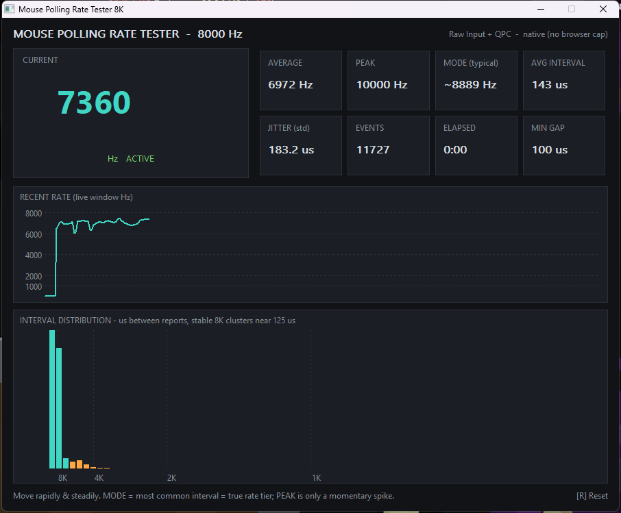

# 鼠标与微动

鼠标是人和电脑之间延迟最低、操作最密集的输入设备之一。这一页按「先合手、再看性能、最后看连接和做工」的顺序讲清楚每个参数到底影响什么，避免被参数表带着走。

## 鼠标怎么选

### 模具与握法（第一位）

参数再强，模具不合手也是白搭。选鼠标先确定自己**怎么握、手有多大**。

**三种主流握法**

| 握法 | 手掌与鼠标的接触 | 发力方式 | 常见偏好 |
| --- | --- | --- | --- |
| 趴握（Palm） | 整个手掌趴满鼠标，掌心贴背、根部贴屁股 | 手臂带动为主 | 高背、长屁股、饱满承托，偏人体工学 |
| 抓握（Claw） | 掌心悬空或虚贴，手指弯曲像爪子扣住 | 手指+手腕混合 | 中高背、屁股顶住掌根、前部收窄 |
| 指握（Fingertip） | 只有指尖和掌根轻点，掌心完全悬空 | 纯手指、手腕微调 | 小而轻、收腰明显、背不必高 |

**看模具的三个维度**

- **背高**：背越高越撑掌心，趴握舒服但指握会顶手；低背灵活、利于抓握/指握快速点按；
- **收腰**：两侧内凹的收腰让拇指和无名指/小指有处捏，抓握、指握尤其看重；
- **屁股长度与饱满度**：屁股顶住掌根才有「依靠」，趴握/大手需要更长更饱满的屁股，指握则偏好短屁股以便手指立起来。

**手长与尺寸**：从中指指尖到手掌根部腕纹的距离是手长。一般来说手长偏小（约 17cm 以下）更适合中小鼠、偏大（约 19cm 以上）更能驾驭大鼠，但这只是起点——握法比手长更能决定你要什么形状（同样手长，趴握要大、指握要小）。

- **对称鼠 / 右手人体工学鼠**：对称鼠左右对称、上手门槛低、换手和握法兼容性好；右手工学鼠右侧有承托无名指小指的造型，长时间趴握更贴合，但只适合右手、握法相对固定。

!!! tip "合手是试出来的，不是算出来的"
    握法分类只是帮助描述，**自己喜欢、顺手才是最重要的，并不存在某一种「最正确、最合适」的握法**。很多人实际是「趴中带抓」的混合握法。参数和尺寸表能帮你缩小范围，最终以实际握持、连续用几天不累为准。

### 传感器与性能

现代旗舰传感器之间的差距已经很小，「传感器够不够用」对绝大多数人早就不是瓶颈，真正要看懂的是下面几组概念，它们经常被混为一谈。

#### 先分清三个容易搞混的「率」

- **传感器帧率（Sensor FPS，也叫采样帧率/摄像头帧率）**：光学传感器底部其实是一个微型摄像头，CMOS 以每秒数千甚至上万帧的速度**拍摄垫面照片**，靠相邻两帧画面的位移算出你移动了多少。帧率越高、单帧像素越多，高速甩动时越不容易「丢帧/跟丢」。它衡量的是**鼠标自己看得有多快**；
- **键盘扫描率（Matrix Scan Rate）**：键盘主控以固定频率逐行扫描按键矩阵、看有没有键被按下，原理和鼠标传感器帧率类似——扫描得越勤，按下被识别得越早。它属于键盘侧的「采样速度」；
- **回报率（Polling Rate，单位 Hz）**：鼠标**每秒向电脑汇报几次坐标**。它衡量的是鼠标把结果「交作业」给电脑的频率，和传感器自己拍多少张照片是两回事。三者关系是：传感器高帧率先保证看得准，高回报率再保证报得勤、电脑收到得及时。

#### 回报率（Polling Rate）到底意味着什么

回报率决定**两次坐标上报之间的间隔**：

| 回报率 | 上报间隔 | 相对 1000Hz |
| --- | --- | --- |
| 125Hz | 8ms | 办公老默认，移动明显发「段」 |
| 500Hz | 2ms | 流畅够用 |
| 1000Hz（1K） | 1ms | 多年来的电竞主流 |
| 2000Hz（2K） | 0.5ms | 更细腻 |
| 4000Hz（4K） | 0.25ms | 当下高刷电竞甜点 |
| 8000Hz（8K） | 0.125ms | 理论极限，代价不小 |

回报率不是越高越好，更不代表一切。很多职业选手至今用 1K、2K 或 4K，原因很实在：

- **从 1K 往上，人能感知的收益快速递减**，但代价线性甚至超线性上升；
- **8K 非常难「稳住」**：它要求传感器、固件、USB、无线链路、CPU、游戏帧率、显示器刷新率**每一环都跟得上**，任何一环掉链子，实际回报就会在 8K 和更低值之间剧烈跳动，反而造成帧时间抖动、画面周期性卡顿；
- 高回报率让鼠标每秒产生数千次 USB 中断，**明显更吃 CPU 单核、更耗电、更挑接口和线材**（详见后文与装机篇联动）。

**什么条件才谈得上稳定 8K**：①传感器与固件原生支持；②插在带宽和控制器都宽裕的 USB 口、用合格线材（有线最稳，无线需星闪或高端 2.4G）；③CPU 单核够强、没有被游戏占满；④游戏本身帧率高且稳定；⑤搭配高刷屏。任何一条不满足，4K 甚至 2K 往往更顺滑。

#### 自己测回报率：本站附带的本地测试器

浏览器在线测试页（Mouse Rate Checker 一类）最多只能较准地测到 1K~4K，瓶颈不在鼠标而在浏览器：浏览器会把一帧内的多次移动**合并（event coalescing）成一个事件**、事件回调受主线程和屏幕刷新率（通常 60~240Hz）节拍限制、JS 时间戳精度也有限，所以 8K 鼠标在网页里常被压到 1K~4K 且乱跳。要测准 8K，得用走 **Raw Input（原始输入，WM_INPUT）**、硬件每上报一次就收一条、并用高精度计时器（QPC，约 0.1 微秒）计时的本地程序。

本站就附带了一个这样的绿色小工具（Windows 10/11，免安装、不依赖运行库、不联网、不写注册表，压缩包里有程序和使用说明，解压即用）：

[:material-download: 下载 MousePoller8K（程序 + 使用说明，解压即用）](tools/mouse-poller/MousePoller8K.zip){ .md-button }

**测试步骤**：①先在鼠标驱动把回报率设到目标档位（如 8000Hz）；②解压后双击 MousePoller8K.exe；③在窗口内**快速且尽量匀速**来回移动 2~5 秒；④看左上角 CURRENT，按 **R** 清零重测。鼠标静止时数字掉到 0、显示 IDLE 是正常的（很多鼠标静止会自动降频/停报），一定要在持续移动时读数。

**界面各指标怎么读**（八个格子分三组，逐个说清）

**第一组 · 你现在到底在多少回报率**

- **CURRENT（当前值）**：最近 512 次上报的滑动平均，最跟手，数字一直在动；
- **AVERAGE（平均值）**：从你按 **R** 清零到现在，全部间隔换算出来的平均回报率；
- **PEAK（峰值）**：整段测量里某一瞬间冲到过的最高值，只代表「最快的一下」，不代表一直这么高；程序加了噪声门限，不会再出现几万 Hz 的假峰值；
- **MODE（typical，众数档位）**：把出现次数最多的间隔换算成回报率，代表你「大多数时候处在哪个档」，是判断鼠标真实档位最可靠的一格。

**第二组 · 间隔本身（单位都是微秒 µs，稳定 8K ≈ 125µs）**

- **AVG INTERVAL（平均间隔）**：相邻两次上报平均隔多久，它和 AVERAGE 是同一件事的两种写法——间隔越短，回报率越高；
- **JITTER（std，间隔标准差）**：衡量这些间隔匀不匀、抖不抖。理想 8K 时每次都≈125µs，它就很小；如果一会儿 125、一会儿 300，它就大，画面也更容易周期性卡顿。它描述的是「整体波动幅度」，越小越稳；
- **MIN GAP（最短有效间隔）**：整段里出现过的最小的「那一个」间隔，是单次最快极值，和 PEAK 互相对应；
- **EVENTS / ELAPSED**：本次一共记到多少次有效上报 / 累计测了多少秒。ELAPSED 就是「测量时长」，它越长、样本越多，上面的平均值越可信；刚测零点几秒时数字乱跳是正常的。

**第三组 · 两张图**

- 上方**折线图**是近期回报率波形，越平越稳；
- 下方**柱状图**是上报间隔的分布，稳定时主峰应聚拢在对应档位的参考线处（8K 就是 125µs）。

!!! tip "明明开了 8K，为什么平均 / MODE 不到 8000？这很正常，别焦虑"
    鼠标只在真正移动时才按设定档位密集上报：你滑得慢、中途有停顿或抬手，就会混进一些更长的间隔，AVERAGE / CURRENT 立刻被这些长间隔拉低（慢滑时平均掉到四五千很常见）；只有快速、持续、尽量匀速地画圈，MODE 才会贴近 6000~8000。判断「是不是真 8K」，看下方柱状图在 125µs（8K 参考线）处有没有成规模的柱群——只要这里有大量计数，就说明鼠标确实在发 8K 数据包。至于「能不能全程稳住 8K」，还取决于 CPU、USB 口、游戏帧率、屏幕和手速，是另一回事；稳不住时降到 4K/2K 往往更顺滑，不必为数字焦虑。

!!! note "JITTER 和 MIN GAP 都用 µs，到底差在哪"
    **JITTER（间隔标准差）看「整体匀不匀」**——对一大堆间隔算离散程度，回答「稳不稳、抖不抖」；**MIN GAP（最短间隔）看「最快的那一下」**——整段里最小的单个间隔（极值），回答「有没有瞬时冲到过」。一个是「面」、一个是「点」：看稳定用 JITTER，看瞬时极限用 MIN GAP / PEAK，别把两者当成一回事。

#### DPI / CPI 与 eDPI

- **DPI（厂商也常叫 CPI）**：鼠标在垫面上每移动 1 英寸，屏幕光标移动多少个计数（点）。DPI 越高，同样物理位移光标走得越远；
- **eDPI（有效灵敏度）= DPI × 游戏内灵敏度**。真正决定「转一次身要甩多远」的是 eDPI，所以**跨鼠标比较手感要比 eDPI，而不是只看 DPI**；
- 常见档位：办公 800~1600；游戏大量玩家集中在 **400 / 800 / 1600**。盲目拉到上万 DPI 通常没有好处：部分传感器在极高 DPI 下精度/平滑处理反而变化，且过高的光标速度难以微操。以「自己能稳定控枪、转身流畅」的 eDPI 为准。

#### 看懂传感器参数：IPS、加速度 G、帧率都是什么意思

参数表里这几个英文最唬人，其实说的是「鼠标在多剧烈的操作下还不跟丢」，逐个拆开：

- **DPI / CPI（分辨率）**：见上，决定移动换算比例，**不是精度越高就越准**；
- **IPS（Inches Per Second，最大追踪速度）**：鼠标每秒能跟上多少英寸的移动速度，超过这个速度传感器就会「跟丢」、光标乱跳。旗舰普遍 650~850 IPS，人类手部极速甩动也就一两百 IPS，旗舰参数是严重过剩的；
- **最大加速度（Acceleration，单位 G）**：鼠标能承受多快的「速度突变」（猛甩、急停）而不丢追踪。这里的 **1G ≈ 9.8m/s²（一个重力加速度）**，50G/60G/75G 就是能扛住几十倍重力的瞬时加速度，同样远超人手，属于「冗余安全垫」；
- **传感器帧率（FPS，帧/秒）**：前面讲过的「每秒拍多少张垫面」。宣传里的「2 万帧竞技固件」，就是把传感器采样帧率做到 20000 FPS 以上的固件——拍得越密，高速移动时相邻两帧越不容易因为画面重叠太少而算错位移，本质是让极限甩动更稳，日常使用感知很小；
- **LOD（静默高度）、DPI 步进、逐只校准**：见下一小节。旗舰常宣传「1 DPI 步进」（DPI 能 1 档 1 档精细调）、「出厂逐只 1% 精度校准」（每只鼠标出厂时把 DPI 误差校到 1% 内），属于锦上添花的一致性保障。

#### 常见传感器型号：先讲清楚，最后一张小表就够

游戏鼠标的光学传感器，绝大多数来自**原相（PixArt，型号 PAW/PWM 开头）**这类谁都能采购的公开通用元件；另有一类是鼠标大厂和原相深度定制、独家供货，或干脆自研自用（不外售）。型号不用背，按「代」来理解就行。

**① 上一代经典 · PAW3395。** 26000 DPI、650 IPS、50G、约 1mm 抬起高度。正是它把「旗舰性能过剩」这件事坐实了——从这一代起，普通人正常使用几乎摸不出传感器之间的差距，如今量大、便宜，仍然完全够用。

**② 当代主力 · PAW3950 及各家定制。** 原生 30000 DPI（定制固件可超到约 42000）、750 IPS、50G，抬起高度低到约 0.7mm，是近几年中高端最常见的一颗。

**③ 新一代旗舰 · PAW3955（含 XM/GT 等定制）。** 原生 40000（定制可超 60000+）、750~850 IPS、60~75G，支持 1 DPI 一档精细步进、2 万帧级采样、出厂逐只校准到约 1% 精度，抬起高度多档可调。参数更顶，但对日常依旧是过剩的。

**④ 厂家独家定制 / 自研，分两条路子：**

- **自研自用**：典型是某厂的 **HERO** 系列，不对外卖、只用在自家鼠标上，主打超低功耗与可调的加速/平滑风格；
- **深度定制、独家供货**：典型是雷蛇（Razer）与原相合作的 **Focus Pro / Focus X** 系列——由原相按其要求定制、仅供它一家使用。公开规格一路演进如下（只列参数、不评好坏）：

| 定制系列 | DPI 步进 | 最大追踪速度 | 最大加速度 |
| --- | --- | --- | --- |
| Focus X 26K | 50 DPI | 500 IPS | 40G |
| Focus Pro 30K | 50 DPI | 750 IPS | 70G |
| Focus Pro 35K（二代） | 1 DPI | 750 IPS | 70G |
| Focus Pro 45K（二代） | 1 DPI | 900 IPS | 85G |
| Focus Pro 50K（三代） | 1 DPI | 930 IPS | 90G |

看得出来，无论公版 PAW 还是厂家定制，旗舰的 IPS/G 都远远超过人手极限，真正的差别在 DPI 步进、抬起高度、表面适应性和固件调校，而不是「谁更快更准」这种玄学。

**公版三代速览（记住「都过剩」三个字即可）**

| 公版型号 | 极限追踪（IPS / G） | 一句话定位 |
| --- | --- | --- |
| PAW3395 | 650 IPS / 50G | 上代经典，量大便宜，至今够用 |
| PAW3950 | 750 IPS / 50G | 当代主力，抬起高度更低 |
| PAW3955 | 750~850 IPS / 60~75G | 新旗舰，1 DPI 步进、2 万帧、逐只校准 |

**型号和后缀怎么看，才不被名字绕进去：**

- 同一公版后面的 **XM / GT / Master** 之类，是鼠标厂向原相定制、特挑或额外调校的版本，参数会有小差别，以该鼠标自己标注的规格为准；
- 别把「传感器后缀」和「鼠标产品后缀」搞混。Pro / Ultra / Air / Master 这类词是鼠标厂商自己的产品分级名，并不是行业统一标准：通常 Ultra/Master/Pro 表示满血或迭代款，Air 多为轻量/精简版，但各家含义不同，一定要回到参数表，而不是靠名字猜高低；
- 宣传里的**「双光协同」「光学编码器」「光微动」**说的是「去机械接触化」：左右键用光/光磁触发、滚轮用**光学编码器**（光耦）代替机械触点，以减少氧化双击和滚轮「回滚」、延长寿命。它们作用在按键和滚轮上，和底部负责追踪的那枚传感器光学不是一回事（微动部分后文细讲）。

#### 主控芯片（MCU）：决定「传得快不快、稳不稳、省不省电」

传感器负责「看」，**主控（MCU）才是鼠标里的小 CPU + 无线电台**：它读传感器数据、跑去抖和各种算法、管无线/有线传输和回报率、调度功耗。所以传感器决定看得准不准，主控决定传得快不快、无线能不能稳跑高回报率、抗不抗干扰、续航长不长。

高端无线鼠标近年大量采用 **Nordic（北欧半导体）nRF52 / nRF54 系列**主控，外设圈口头说的「54」就是 nRF54 这一代（公开芯片规格）：

| 主控 | 规格（公开） | 特点 | 大致定位 |
| --- | --- | --- | --- |
| nRF54H20 | 多核 320MHz Cortex-M33 + RISC-V，2MB/1MB，第 4 代 2.4G 射频、480Mbps 高速 USB | 射频灵敏度/抗干扰最强、算力最高、延迟最低，代价是功耗和成本更高 | 现役旗舰 |
| nRF54LM20（A/B） | 128MHz M33，2MB / 512KB，原生高速 USB | 性能紧追 H20，原生支持无线 8K，功耗明显更低、续航更好 | 高端「甜点」 |
| nRF54L15 | 同代入门规格 | 也能做到 8K，但「能」和「强」是两回事，余量/抗干扰小一档 | 中高端 |
| nRF52840 / nRF5340（上代） | 上一代经典平台 | 1K~4K 时代完全够用，存量巨大 | 经典主流 |

补充几点，避免被宣传绕进去：

- 主控后面的 **L / H、LM20 / H20 是芯片厂自己的型号分级**（算力、射频、存储、功耗不同），和鼠标产品的 Pro/Ultra 命名又是两套体系；
- 所谓「自研主控 / 双主控 / 竞技固件」，多是厂商在公版芯片基础上做板级设计、射频天线、固件调校或冗余设计，不必神化参数，最终看实测延迟、复杂环境抗干扰和续航；
- 好主控的实际好处很朴素：无线高回报率更稳、旁边有路由器/USB3 设备时不容易丢帧、低去抖也不容易误触发、续航更长。

#### 其它关键传感器概念

- **LOD（Lift-Off Distance，抬起距离/静默高度）**：鼠标抬离垫面**多高之后停止追踪**。低 LOD 对 FPS 很重要——甩枪后把鼠标抬回垫中央时，光标不会因为悬空斜移而「带偏」。多数人偏好低 LOD，具体高度可在驱动里调；
- **角度捕捉 / 直线修正（Angle Snapping / Prediction）**：传感器或软件把你略带抖动的移动「拉直」成水平线。画图可能有用，但**竞技游戏一般要关掉**，因为它会篡改你的真实轨迹；
- **传感器角度旋转（Sensor Rotation / 斜装）**：部分鼠标允许把传感器按角度斜装、或在驱动里旋转采样坐标系，让**无论哪种握姿，手腕最自然的摆动方向都对应屏幕上的水平移动**，减少为了画直线而别扭地拧手腕。它和「直线修正」是两回事：一个是校准你手的自然方向，一个是替你抹平轨迹；
- **按键去抖延迟（Debounce Time）**：机械微动一次按下时金属弹片会在极短时间内抖动多次，主控要等信号稳定后才认定「这是一次点击」，这段等待就是去抖时间。设得短，点击响应更快但更容易误判双击；设得长更稳但更「肉」。可调去抖时间的鼠标可在「快」和「稳」之间权衡；
- **加速度/平滑（Acceleration / Smoothing）**：好的游戏传感器应做到「手怎么动、光标怎么动」，不随移动快慢改变距离、不额外插帧平滑，这也是「原生 1:1 输入」被看重的原因。

#### 全链路延迟：比「8K=0.125ms」更该关心的事

8K 的 0.125ms 只是「**两次 USB 上报之间**」这一小段。从你手指发力、到游戏画面里枪真正转过去，是一整条链：

<figure>
传感器扫描成像 → 主控处理/去抖 → 无线或有线传输 → USB 上报 → 系统输入栈 → 游戏引擎采样 → 渲染 → 显示器刷新出光
</figure>

- 厂商宣传的「0.1xx ms 全链路 / 端到端延迟」，指的是前面**几段硬件链路之和**，而且各家口径不一样（有的只算到 USB，有的算到引擎），数字不能直接横比；
- 下游都是「按拍子采样」的：游戏服务器常见 64 / 128 tick（一拍约 15.6 / 7.8ms），屏幕 144 / 240 / 360Hz 一帧约 6.9 / 4.2 / 2.8ms。某一环节快到远小于「一帧/一个采样拍」，下游根本采不到，等于被量化掉了；
- 所以真正影响手感的是**整条链稳定在个位数毫秒、且不抖**，而不是把某一项刷到 0.1ms 以内。这也是为什么职业选手不必追 8K、磁轴 RT 也不必调到 0.01mm（键盘篇还会展开）。

### 重量、脚贴与垫面

- **轻量化有什么用**：鼠标从早年百克以上一路做到五六十克甚至更轻。重量轻，移动惯性就小，急停、急转、快速微调更跟手；长时间甩动手腕和前臂负担更小，有助于减轻疲劳和劳损，这也是 FPS 玩家普遍偏好轻量化的原因；
- **但不是越轻越好（极致轻量化的代价）**：为了减重会用更薄的壳、更小的电池，可能牺牲抗摔强度和续航；腔体变空还可能出现空响键音；过轻的鼠标在低灵敏度、手臂大幅拉枪时也可能让人觉得「发飘」、缺一点稳定感。重量之外，重心位置和前后平衡同样重要，按自己力量和控枪习惯选，不必盲目追「全球最轻」；
- **脚贴（脚垫）**：常见特氟龙（PTFE），滑、静音、便宜；玻璃脚贴更滑更耐磨但更挑垫面、声音偏大。脚贴边缘是否圆润、和垫面的搭配直接决定「启动—滑动—停下」的手感；
- 鼠标与鼠标垫是一套系统，具体垫面选择见[鼠标垫](鼠标垫.md)。

### 连接方式：有线 / 2.4G / 蓝牙 / 星闪

- **有线**：最稳、零供电焦虑、最容易跑满高回报率，缺点是拖一根线（软伞绳线能大幅缓解拖拽感）；
- **2.4G 接收器**：游戏无线主力，延迟已接近有线，需要占一个 USB 口，尽量用**延长底座把接收器放到离鼠标近的位置**、避开 USB3 设备干扰；
- **蓝牙**：省电、可在多设备间切换、不用占接收器，但延迟和回报率上限相对最低，适合办公而非竞技；
- **星闪（NearLink）**：近年兴起的国产短距无线标准，面向键鼠的 SLE 模式主打**微秒级低延迟、抗干扰和无线高回报率（可做到无线 4K/8K）**。要特别注意它和蓝牙的使用差别：电脑/手机并没有通用的星闪主机协议栈，星闪键鼠目前基本要插上随附的「星闪接收器（或星闪网关）」才能工作——它不像蓝牙那样能被任意一台带蓝牙的主机直接搜索、配对、直连；脱离配套接收器，通常就只能退回普通 2.4G/蓝牙模式。买星闪外设时，把「是否带接收器、支持到几 K 回报率」一起确认。

## 微动（按键开关）

左右键脆不脆、会不会用着用着「双击」，都由微动决定。这一节把原理、常见型号和 DIY 换微动一次讲清。

### 触发原理：机械、光学、光磁、光机混合、霍尔

- **机械微动**：最经典，内部是金属弹片 + 触点，按下=弹片形变让两个触点碰在一起。手感来自弹片的脆/闷、键程、触发压力和回弹，优点是段落和反馈清晰、选择极多，缺点是触点会氧化、进灰进汗，用久了可能双击；
- **光学微动**：用一束红外光的「通/断」代替金属接触，没有触点氧化问题、寿命长、触发快，但仍靠机械结构回弹，手感风格和纯机械不同；
- **光磁微动**：用一根小钢杆/拨片去「切割」PCB 上的光栅、再靠一块永磁体吸回回弹，既没有金属弹片、也没有触点，从结构上规避了氧化双击和手感衰减；
- **光机混合（如 LIGHTFORCE 一类）**：用光学导通换来低延迟和不氧化，同时保留机械结构的清脆段落手感，等于「光学触发 + 机械手感」叠加。注意它**不是霍尔磁微动**——某些旗舰鼠标（如罗技 GPW 二代以后用的 LIGHTFORCE）就属于这一类，别被「光磁/电磁」的名字绕晕；
- **霍尔 / 磁微动**：靠磁场变化感应触发、全程无物理触点，思路和键盘上的磁轴同源，在鼠标上相对少见。

一句话总结：近年这些「光学/光磁/电磁/光机混合」新名词，本质都是把会氧化的金属触点去掉、以求根治双击，区别只在「靠光还是靠磁触发、靠什么结构回弹和给手感」。

### 常见机械微动型号与参数怎么看

看一颗机械微动，主要看四个参数：

- **动作力（OF，单位 gf 或 N，1N≈102gf）**：按下去需要多大力，常见约 45~75gf（0.45~0.75N），力越小越轻盈、越大越扎实；
- **行程**：总行程/触发行程，游戏微动多在 2mm 上下，短行程触发更快；
- **寿命（点击次数，M = 百万次）**：触点能扛多少次点击，如 50M=5000 万次、80M=8000 万次；
- **触点材质**：金触点比银/镍合金更抗氧化、更不容易双击，成本也更高。

几家最常见的逐个说（只讲通用规格，不评价具体鼠标品牌）：

- **欧姆龙 OMRON D2FC 系**：最常见的日系机械微动，按寿命分档——**20M**（白点，约 0.59N，量大、手感均衡）、**50M**（很多旗舰的定制款）、**60M**（橙点，更长寿）、**100M**（一亿次的顶级寿命档）；另有日产 **D2F-01F（灰点）**，是老玩家口中「脆」的代表，如今已经很少见。
- **凯华 Kailh GM 系**：GM4.0 / GM8.0，GM8.0 约 8000 万次、金触点抗氧化、约 2mm 行程、触发利落。
- **TTC**：防尘金 / 80M 黑点一类，最高 8000 万次级，偏线性均衡，带防尘结构、不容易因进灰双击。
- **华诺 / 环诺 / 德丰等国产**：蓝壳粉点等，部分型号偏软，档位和手感选择非常丰富。

精简速览（**M = 百万次点击**）：

| 品牌 / 系列 | 常见寿命档 | 一句话特点 |
| --- | --- | --- |
| 欧姆龙 D2FC | 20M / 50M / 60M / 100M | 最常见、手感均衡，白点入门、橙点更长寿 |
| 欧姆龙 D2F-01F（灰点） | 日产，已少见 | 老派「脆」声代表 |
| 凯华 GM | GM4.0 / GM8.0（约 8000 万） | 金触点抗氧化、短行程、触发利落 |
| TTC 防尘金 | 最高约 8000 万 | 线性均衡、带防尘结构 |
| 华诺等国产 | 各档位 | 选择丰富、部分偏软 |

- **「厂商定制微动」是怎么回事**：鼠标厂会找这几家微动厂，按自己想要的力度、回弹和键音调一批特供款，换个颜色点或起个名字，本质仍是上述几类机械/光学微动，看动作力、寿命、触点材质就能还原它的底子。

### 为什么很多人 DIY 换微动 / 热插拔

- **修复双击**：老鼠标触点氧化、弹片疲劳后连击，换一对新微动就能「复活」，比整只换划算；
- **换手感/键音**：有人喜欢更脆、有人喜欢更闷，换不同动作力和行程的微动能调出自己的味道；
- **升级寿命**：换成金触点、更高寿命或光学/光磁微动，根治双击、延长使用周期。

两种换法：

- **热插拔微动座**：主板上是插座而非焊盘，用镊子拔插即可，不用烙铁，是最友好的 DIY 形式；
- **焊接式**：需要拆开鼠标、用电烙铁把旧微动拆下焊上新的，动手门槛高一些。

!!! warning "换微动的两个注意点"
    一是左右键最好成对、同型号同批次更换，否则两边手感不一致反而别扭；二是新微动的动作力/总行程要和外壳按键柱匹配，太高会「顶键」、太低会有空程，换之前先确认尺寸兼容。

### 寿命与双击

- **双击/连击的成因**：机械触点长期使用后表面氧化、弹片疲劳、进灰进汗，导致一次按下被识别成两次；静电和受潮也可能诱发；
- **寿命参数怎么看**：标称点击次数（5000 万、8000 万、1 亿次）只代表触点耐久量级，手感一致性、防尘防汗、触点材质同样重要，不是数字大就一定好用；
- **应对**：优先换微动（见上）；不方便拆的，也可先尝试清洁、或在驱动里适当调大去抖时间缓解。

### 滚轮与编码器（容易忽略）

- 滚轮刻度感来自**编码器**：刻度分明利于武器/网页一格格精确切换，阻尼松垮、**回滚（往下滚却反向跳一格）是机械编码器老化的典型表现**，换成光学编码器能明显改善；
- **滚轮防误触**：注意中键（按下滚轮）是否过硬/过松、左右倾斜滚轮是否容易误触；部分鼠标可在驱动里关闭倾斜键或调节滚轮行数以避免误操作；
- 部分鼠标提供「刻度/无极（自由飞轮）」两种滚轮模式切换，长文档/网页浏览用无极更省力。

## 按游戏类型选

| 类型 | 关注点 | 建议方向 |
| --- | --- | --- |
| FPS（射击） | 定位稳定、低 LOD、跟手、重量轻 | 合手的对称/工学模具 + 够用的传感器，回报率 1K~4K 按 CPU 量力，低 LOD、合适重量 |
| MOBA | 高频点击、侧键、微动回弹快 | 触发轻快、回弹跟手的微动，2~4 个顺手侧键 |
| MMO | 大量技能/宏 | 多侧键、可自定义宏的鼠标，但注意别为用不到的侧键牺牲握感 |
| 办公 | 静音、滚轮、多设备切换 | 静音微动、舒适趴握模具、支持多设备（2.4G/蓝牙/星闪）切换 |

## 高回报率的 CPU 门槛（与装机篇联动）

- **1000Hz 回报率对绝大多数 CPU 毫无负担**；但 4000 / 8000Hz 鼠标每秒要产生数千次中断，开始吃单核性能；
- 当 CPU 偏弱、或已被游戏占满时，超高回报率可能造成占用瞬间飙高、帧时间抖动、**移动鼠标反而掉帧 / 画面周期性卡顿**；
- Intel 大小核平台，可把游戏和鼠标驱动固定到性能核（P 核），避免输入被丢到小核排队；AMD 同构平台也可固定到高主频核心；
- 外设体验是有「CPU 门槛」的：CPU 不够时，把回报率从 8K 降到 1K~2K 往往更顺滑。反过来，CPU 太弱时，太高端的高回报率键鼠也可能「带不动」。

!!! success "一句话对号入座：你该盯哪几个参数"
    - **竞技 FPS**：模具合你的握法（趴 / 抓 / 指）排第一，其次轻量、传感器不拉胯、低延迟 2.4G；上高回报率前先确认 CPU 带得动。
    - **MOBA / MMO / 生产力**：侧键数量与位置、模具跟手、微动确认感。
    - **办公 / 中大手长时间用**：模具贴合饱满、静音微动、蓝牙多设备切换与续航。
    - **所有人**：模具合手比传感器纸面参数更决定手感，而且是「试」出来的；脚贴和垫面要一起算。

[:material-chip: 原理见电脑篇 · CPU 核心 / 绑核 / 轮询率](../电脑/装机/硬件.md){ .md-button }

[:material-keyboard: 键盘轴体与连接方式](键盘-机械轴与磁轴.md){ .md-button }

